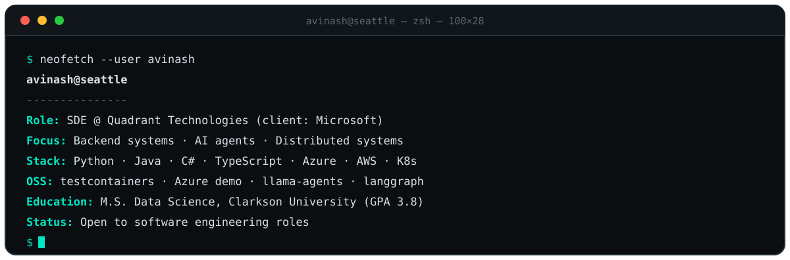

<!--
  Profile README for github.com/AvinashKalamati
  · Artwork lives in assets/ (hero + whoami cards, dark/light variants).
  · Optional later: a daily readme-sync workflow to refresh the "Recently shipped" table,
    and the snake workflow that renders the contribution animation to the `output` branch.
-->

<a href="https://www.linkedin.com/in/avinashkalamati">
  <picture>
    <source media="(prefers-color-scheme: dark)" srcset="assets/hero-dark.svg">
    <source media="(prefers-color-scheme: light)" srcset="assets/hero-light.svg">
    
  </picture>
</a>

<p align="center">
  <a href="https://www.linkedin.com/in/avinashkalamati"></a>
  <a href="https://github.com/AvinashKalamati"></a>
  <a href="https://www.linkedin.com/in/avinashkalamati"></a>
  <a href="mailto:avinashkalamati@gmail.com"></a>a>
</p>

<p align="center">
  <kbd><a href="#whoami">whoami</a></kbd>&nbsp;
  <kbd><a href="#open-source">open source</a></kbd>&nbsp;
  <kbd><a href="#recently-shipped">recently shipped</a></kbd>&nbsp;
  <kbd><a href="#how-i-build">how I build</a></kbd>&nbsp;
  <kbd><a href="#experience">experience</a></kbd>&nbsp;
  <kbd><a href="#stack">stack</a></kbd>&nbsp;
  <kbd><a href="#activity">activity</a></kbd>
</p>

## whoami

<picture>
  <source media="(prefers-color-scheme: dark)" srcset="assets/whoami-dark.svg">
  <source media="(prefers-color-scheme: light)" srcset="assets/whoami-light.svg">
  
</picture>

## Open source

I contribute to the Python and AI-infrastructure tools I build on — real fixes and features, each shipped with tests, in projects with active maintainer review.

### Featured: `GcsContainer` for testcontainers-python

A new container module that runs Google's `fake-gcs-server` emulator in tests, so GCS code can be integration-tested without cloud credentials. Modeled on the repo's existing Datastore pattern, with docs and tests included.


```python
from testcontainers.community.gcs import GcsContainer

with GcsContainer() as gcs:
    client = gcs.get_client()
    bucket = client.create_bucket("test-bucket")
    bucket.blob("hello.txt").upload_from_string("Hello from the emulator!")
```

**Why it holds up:** a downstream project (panodata/omniload) swapped it in as a drop-in replacement for its own hand-rolled container — all 3 of its GCS integration cases passed unchanged, at the same runtime.

### Contributions

| Project | What I shipped | Status |
| --- | --- | --- |
| [testcontainers-python](https://github.com/testcontainers/testcontainers-python/pull/1145) | New `GcsContainer` module (fake-gcs-server) with docs and tests | Maintainer-approved, awaiting CI/merge |
| [azure-search-openai-demo](https://github.com/Azure-Samples/azure-search-openai-demo/pull/3250) | Fix: search results without a reranker score were all filtered out on the free Azure AI Search tier | All 21 CI checks green, awaiting review |
| [llama-agents](https://github.com/run-llama/llama-agents/pull/838) | Root-cause fix for `PickleSerializer` returning wrong values for JSON payloads, with regression tests | Open, awaiting review |
| [langgraph](https://github.com/langchain-ai/langgraph/issues/9475) | Fix in progress: Functional API resume re-runs a task whose exception was caught instead of replaying its recorded outcome | Claimed, building |

### Recently shipped

| Date | Work |
| --- | --- |
| `2026-10-28` | Claimed langgraph #9475 — checkpoint task-replay bug in the Functional API |
| `2026-10-27` | Opened llama-agents PR #838 — PickleSerializer round-trip fix (+203/−4, regression tests) |
| `2026-10-26` | Opened testcontainers-python PR #1145 — new `GcsContainer` module (+262/−2) |
| `2026-10-23` | Opened azure-search-openai-demo PR #3250 — reranker-score filtering fix |

## How I build

```
flowchart LR
    BUG["Bug report"] --> REPRO["Reproduce locally"]
    REPRO --> ROOT["Find the root cause"]
    ROOT --> FIX["Fix + regression tests"]
    FIX --> PR["Pull request"]
    PR --> REV["Maintainer review"]
    REV --> MERGE["Merged"]
```

| Principle | What it looks like in practice |
| --- | --- |
| **Root cause over patches** | In llama-agents, the serializer bug had narrower fixes that only tightened validation; mine corrects the decode ordering that caused it, so the whole class of bad round-trips is covered. |
| **Reproduce first** | Every fix starts from the reporter's repro, run locally — no repro, no patch. |
| **Tests ship with the fix** | Regression tests land in the same PR (#838, #1145), so the bug stays fixed. |
| **Fit the codebase** | New modules follow the repo's own patterns — `GcsContainer` mirrors testcontainers' Datastore module — and PRs include docs, changelog entries and CLA housekeeping. |

## Experience

**Software Development Engineer · Quadrant Technologies · *Jun 2025 – present · Redmond, WA***

- Backend engineering with Python and Java: REST APIs, PostgreSQL, and distributed services on AWS.
- Ship and operate containerized services with Docker, Kubernetes and Jenkins CI/CD.
- Build on LLM infrastructure — retrieval systems and AI-backed services.

**Co-founder · Doppular**

- Co-founded Doppular, a social app that matches you with people around the world who look like you — *alike in looks, unique in life.*

**Education:** M.S. in Computer Science
## Stack

| Layer | Tools |
| --- | --- |
| **Languages** | Python · Java · SQL |
| **Backend** | REST APIs · PostgreSQL · distributed systems · microservices |
| **Cloud & DevOps** | AWS · Docker · Kubernetes · Jenkins · Git · GitHub Actions · Linux |
| **AI & LLM** | LangChain · LangGraph · LlamaIndex · Azure AI Search · RAG systems |


## Activity

<!-- The snake needs the Platane/snk workflow writing to the `output` branch; add it when ready.
<picture>
  <source media="(prefers-color-scheme: dark)" srcset="https://raw.githubusercontent.com/AvinashKalamati/AvinashKalamati/output/github-contribution-grid-snake-dark.svg">
  <source media="(prefers-color-scheme: light)" srcset="https://raw.githubusercontent.com/AvinashKalamati/AvinashKalamati/output/github-contribution-grid-snake.svg">
  
</picture>
-->

<p>
  
  
</p>

**Let's build systems that ship.** Open to software engineering roles — backend, distributed systems, AI infrastructure.

<a href="https://www.linkedin.com/in/avinashkalamati"></a>


